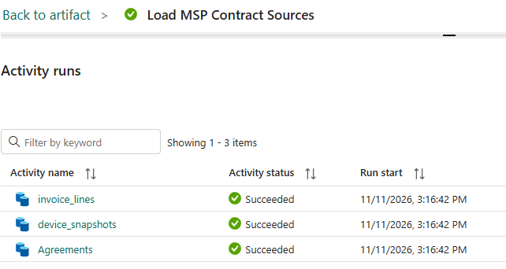
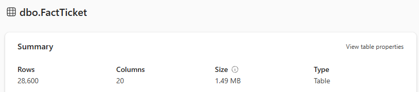

# MSP Operations & Profitability

**Adam Khemiri · Independent data analytics project · Simulated data**  
**Microsoft Fabric, T-SQL, Power BI, DAX, Excel**

[Open the three-page Power BI report (PDF)](report/MSP%20Operations%20%26%20Profitability.pdf)

I used my IT support experience to frame a question for a fictional managed service provider (MSP). When a client account loses money, how much comes from billing errors and how much comes from the cost of delivering support?

## Findings

- **Billing corrections would improve margin by 1.17 percentage points.** Comparing eligible workstations against billed quantities and signed rates identified **$28,860 in simulated underbilling**. Holding costs fixed, correcting billing would move the 24-month managed-services gross margin from **12.41% to 13.58%**.
- **Two loss-making accounts need different actions.** In February 2025, Everywhere Dentistry had 100 eligible workstations and was billed for 80 at $45 each. Correcting the count would close a **$900 billing gap**, leaving a **$2,494 gross loss** after allocating service payroll. Apex Precision Machining was fully billed and still lost **$24,111.74** in gross profit over May–October 2026. The recovery plan prioritizes reviewing Apex's pricing before its December 3, 2026 notice deadline and correcting Dentistry's billed count before reviewing its renewal rate.
- **Project margins change when all engineering payroll is included.** The February 2025 rollout earned **$3,000 of direct gross profit** on **$10,000 in revenue**. That month, the project department recorded an **$8,440 gross loss** after charging the full engineering payroll. Across 24 months, the company recorded **$329,181.60 in gross profit** and a **$254,318.40 operating loss** after overhead.

## Power BI report

The PDF shows all clients and all 24 reporting months. Tables show the rows visible on each report page at export.

1. **Service Demand & Quality.** Ticket trends, service-level agreement (SLA) results, and survey feedback by recorded closing technician. SLA metrics are grouped by the month tickets were opened. The rates use 24/7 elapsed time and include tickets with a recorded first response or resolution, respectively. Survey metrics are grouped by the month tickets were closed.
2. **Client Contracts & Recovery Plan.** Managed revenue, gross margin, and billing gaps by client and month. The October 31, 2026 renewal snapshot uses May–October 2026 costs to estimate the monthly rate per workstation needed for a 30% gross margin at the same delivery cost and device volume.
3. **Business Performance.** Company revenue, gross profit, and operating profit, with monthly trends and a comparison of project margin using logged labor and using full engineering payroll.

## How I built and checked the report

The fictional dataset covers November 2024 through October 2026 across **14 CSV files**. It includes scenarios for billing discrepancies, contract pricing, and payroll allocation. Fabric Data Factory pipelines and Dataflow Gen2 brought the data into the Warehouse. T-SQL consolidated two ticket deliveries into **28,600 distinct tickets**, reconciled billing and payroll, and built reporting tables for a Direct Lake Power BI model. DAX measures calculate report totals and margins under the selected filters.

- [Excel operating profit reconciliation](validation/MSP%20Operating%20Profit%20Reconciliation.xlsx) uses XLOOKUP to match Power BI and Fabric Warehouse results by month. **24 of 24 months match to the cent**, totaling **−$254,318.40** in each source. The workbook opens without a Fabric connection.
- [Power BI model diagram](model/semantic-model.png), [relationship settings](model/relationships.md), and [DAX measures](model/dax-measures.md) show how the report handles date roles, client filters, and financial calculations.
- [Synthetic source data](data/msp-synthetic-source-data.zip) contains the 14 CSVs and a data dictionary with the purpose, keys, and columns for each file.

### Fabric screenshots

**Contract source pipeline.** Run history shows all three Copy activities succeeded for agreements, device snapshots, and invoice lines.

**Ticket reporting table.** The Warehouse overview shows 28,600 rows in `dbo.FactTicket`, with one row per ticket after consolidating the source deliveries.

### Selected Fabric Warehouse SQL

Start with the billing query for the main finding. These are examples from the Warehouse build. The table builds rely on existing source tables and intermediate views in Fabric.

| SQL example | What it shows |
|---|---|
| [Billing reconciliation](sql/managed_billing_reconciliation.sql) | Compares eligible workstations with billed quantities and applies the signed agreement rate. |
| [Contract profitability](sql/managed_contract_profitability.sql) | Allocates remaining service payroll by eligible workstation count and reconciles costs to payroll. |
| [Renewal pricing](sql/contract_renewal_pricing.sql) | Estimates the rate needed for a 30% gross margin and surfaces notice deadlines. |
| [Business performance](sql/business_performance.sql) | Builds monthly company results and project-level direct profit. |
| [Ticket reporting](sql/ticket_reporting.sql) | Builds the reporting model for ticket volume, closures, and SLA measures. |
